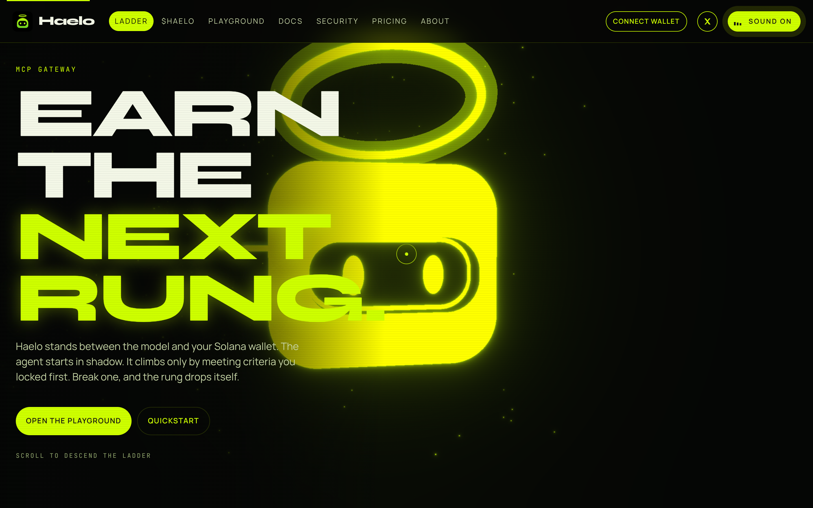
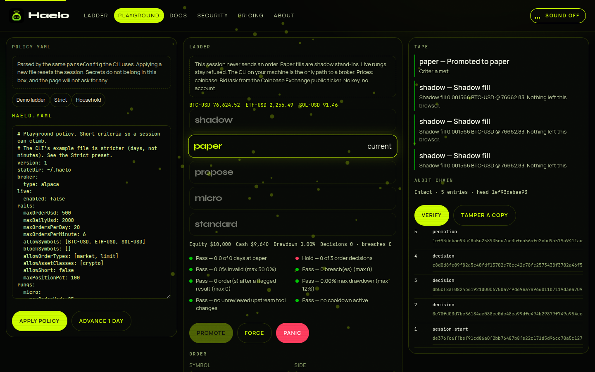
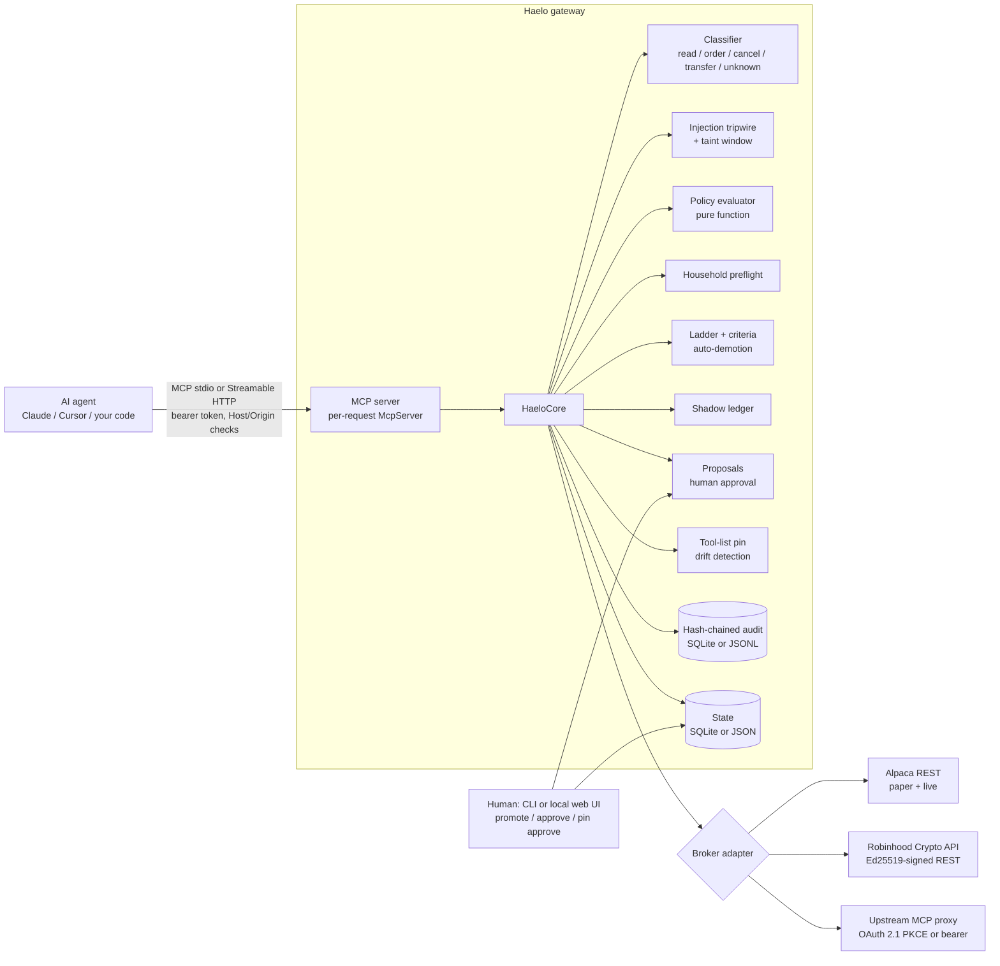

<p align="center"></p>

# Haelo

**An autonomy ladder for AI trading agents.** Haelo is an [MCP](https://modelcontextprotocol.io) gateway that sits between your agent and your broker. The agent starts on a short leash (everything simulated), and earns more freedom only by meeting criteria **you wrote down in advance**. Break a rule and it is demoted automatically, with no human in the loop.

```
shadow ──► paper ──► propose ──► micro ──► standard
 simulated   broker     you approve   live, tiny    live, your
 on live     paper      every order   caps          full rails
 quotes      account
```

> **Not financial advice. Not a guarantee.** Haelo reduces how badly an agent can hurt you. It does not make trading safe or profitable. Read [Limitations](#limitations) and [SECURITY.md](SECURITY.md) before connecting real money.

[](https://github.com/HaeloBot/Haelo/actions/workflows/ci.yml)
MIT licensed · Node ≥ 22.13 · TypeScript · official MCP TypeScript SDK (v2) · SQLite (built-in `node:sqlite`)

The website playground runs this repository's policy engine, ladder, and audit chain in the browser, in shadow only. It never asks for a broker key. Live trading stays on the local CLI. The Vercel URL will be added here once the project is deployed.

## Deploy to Vercel

[](https://vercel.com/new/clone?repository-url=https%3A%2F%2Fgithub.com%2FHaeloBot%2FHaelo&project-name=haelo&repository-name=haelo)

The app lives in `website/` and imports the engine from `src/` (policy, ladder, shadow ledger, audit chain). Use these project settings. `website/vercel.json` already sets the framework, install, build, output, and the SPA rewrite.

| Setting | Value |
|---|---|
| Root Directory | `website` |
| Include source files outside of the Root Directory in the Build Step | **On.** Required. New Vercel projects enable this by default. The playground imports `../src`. |
| Framework Preset | Vite |
| Install Command | `npm ci` |
| Build Command | `npm run build` |
| Output Directory | `dist` |
| Environment variables | None. `VERCEL` is set by the platform and keeps the Vite base at `/`. |

Deep links (`/playground`, `/docs`, and the rest) rewrite to `/index.html`. Static files are served first. No broker keys, and no GitHub Pages base path.

<p align="center"></p>
<p align="center"></p>

---

## Why

Giving an agent a brokerage login is all-or-nothing. Haelo makes it a ladder:

| Rung | What happens to an order | Money at risk |
|---|---|---|
| `shadow` | Simulated against live quotes, with slippage and fees. Never reaches the broker. | none |
| `paper` | Sent to the broker's paper environment (Alpaca). Skipped for brokers with no paper environment. | none |
| `propose` | Held. A human reads an approval card built from the canonical order fields and approves or declines. | only what you approve |
| `micro` | Sent live automatically, under much tighter caps (default $25/order, $100/day, 5 orders/day). | tiny |
| `standard` | Sent live under your full rails. | your limits |

**Promotion is human-only** and requires criteria you set before the agent ran (minimum days, minimum decisions, maximum invalid-order rate, zero rule breaches, zero prompt-injection follow-throughs, maximum drawdown, no tool-list drift). **Demotion is automatic**:

| Event | Default response |
|---|---|
| Hard rule breach (e.g. order over the cap) | straight back to `shadow` |
| Drawdown over the limit | down one rung |
| Upstream tool list changed since it was pinned | `shadow`, and orders freeze until a human runs `haelo pin approve` |
| Order placed right after text that looks like a prompt injection | blocked, down one rung |
| Any demotion | promotion frozen for a cool-down (default 24 h), open orders cancelled |

The agent has **no tool** that promotes, demotes, approves, or edits policy. It can ask (`haelo_request_promotion`) and read its own status.

**Live trading is off by default.** `live.enabled: false` in the policy means no order can reach a live account: live rungs cannot be promoted into (not even with `--force`) and approved proposals are refused. Going live is a deliberate, policy-locked edit plus a passing `haelo doctor --live`. See [docs/GO_LIVE.md](docs/GO_LIVE.md).

## What is real and what is not

Be skeptical of any trading tool that does not say this up front. Here is the verification matrix.

| Component | Status |
|---|---|
| MCP server (stdio + Streamable HTTP, official SDK v2, real client in tests) | **Verified** by automated end-to-end tests |
| Policy engine, ladder, shadow ledger, household preflight, audit chain, SQLite + JSONL storage, CLI, web approvals UI | **Verified** by automated tests (unit, property-based, end-to-end; coverage enforced in CI) |
| `haelo doctor` | **Verified** against local mocks of each broker. It makes only read-only requests |
| Alpaca adapter (paper + live) | A real REST client for the documented endpoints. Verified **only against a local mock server** that follows Alpaca's documented shapes. **Not yet run against Alpaca itself.** Use `haelo doctor` (read-only) or `npm run smoke:alpaca` (paper order far from market, then cancel) with your keys |
| Robinhood Crypto Trading API client | Ed25519 signing **verified byte for byte against the official documentation example**. Endpoints are verified against a mock only. **Not yet run against Robinhood.** `haelo doctor` and `npm run smoke:robinhood-crypto` make real signed GETs |
| Robinhood official agentic-trading MCP via `mcp-upstream` | Proxy mechanics are verified over real Streamable HTTP against a mock upstream. **OAuth 2.1 + PKCE `haelo auth` is verified end to end against a local spec-compliant mock IdP** (RFC 9728 / 8414 / 7591, S256). Robinhood does **not publish** its tool schemas, so extraction is tolerant and fails closed. **Unverified against the real service** |
| Token storage | OS keychain through `@napi-rs/keyring` (macOS Keychain, Windows Credential Manager, Linux Secret Service/keyutils), with a 0600 file fallback. `haelo doctor` reports which one is in use |
| Shadow fills | A simple model (quote ± slippage). **Good shadow results are weak evidence about live results** |
| Wash-sale and lot checks | Heuristic warnings, **not tax advice**. Crypto wash-sale applicability is unverified, so it is off by default |

Nothing here is a stub presented as working. Where something cannot be checked without credentials, it says so.

## Quickstart (no broker account needed)

```bash
git clone https://github.com/HaeloBot/Haelo && cd haelo
npm ci && npm run build

# 1. a local mock broker MCP server (test double, see the matrix above)
node dist/cli.js mock-upstream --port 8799 &

# 2. policy + state
mkdir /tmp/haelo-demo && cd /tmp/haelo-demo
node /path/to/haelo/dist/cli.js init --broker mock
node /path/to/haelo/dist/cli.js policy lock

# 3. preflight, then serve over stdio for an MCP client, or HTTP for anything else
node /path/to/haelo/dist/cli.js doctor
node /path/to/haelo/dist/cli.js serve --http          # prints the URL; token is in <stateDir>/http-token
node /path/to/haelo/dist/cli.js status                # rung, caps, stats
node /path/to/haelo/dist/cli.js report                # shadow scorecard + promotion checklist
```

### With Alpaca paper (free account)

```bash
export ALPACA_PAPER_KEY_ID=PK...  ALPACA_PAPER_SECRET_KEY=...
haelo init --broker alpaca && haelo policy lock
haelo doctor                               # read-only: keys, account status, market data
npm run smoke:alpaca                       # real API check: account, quote, order, cancel (paper only)
haelo serve --stdio
```

### With Robinhood

* **Crypto Trading API** (US only, API credential from your account): `haelo init --broker robinhood-crypto`, set `RH_CRYPTO_API_KEY` and `RH_CRYPTO_PRIVATE_KEY`, run `npm run smoke:robinhood-crypto` (read-only) first.
* **Official agentic-trading MCP**: `haelo init --broker mcp-upstream`, run `haelo auth`, then look at the upstream's `tools/list` and name the tools in `haelo.yaml` (`quoteTools`, `accountTool`, ...). Brokers with no paper environment skip the `paper` rung.

Neither Robinhood path has been run against Robinhood by the author. Start at `shadow` and read the audit log.

## Connect an agent

* Claude Desktop: [`examples/claude-desktop.stdio.json`](examples/claude-desktop.stdio.json) (HTTP variant: `claude-desktop.http.json`)
* Cursor: [`examples/cursor.mcp.json`](examples/cursor.mcp.json) (HTTP variant: `cursor.mcp.http.json`)
* Your own code: [`examples/sdk-client.ts`](examples/sdk-client.ts) uses the official client.

The agent sees the broker's read tools, a normalized order tool (or the upstream's own order tools), and up to eight `haelo_*` tools (`haelo_propose_order` appears only with the normalized order tool): `haelo_status`, `haelo_preflight` (dry-run an order), `haelo_propose_order`, `haelo_get_proposal`, `haelo_explain_block`, `haelo_record_rationale`, `haelo_shadow_report`, `haelo_request_promotion`.

## The human's commands

```
haelo status | report                 where is the agent, and is it eligible to move up
haelo promote [--force]               one rung up if criteria are met (--force is audited)
haelo demote | panic                  one rung down, or straight to shadow + cancel open orders
haelo proposals                       orders waiting for you
haelo approve <id> | decline <id>     approval card, then type the id to confirm
haelo approvals-ui                    the same, as a local web page (loopback, token login, CSRF-protected)
haelo doctor [--live]                 read-only preflight of config, storage, keys and connectivity
haelo pin status | approve            review a changed upstream tool list
haelo audit verify | tail | export    check the hash chain, read it, export it as JSONL
haelo policy lock | check | show      pin the policy file's hash
```

## Architecture



How a call flows: classify the tool by name (annotations are **not** trusted) → transfers and unknown tools are hidden from `tools/list` *and* blocked if called → for orders, extract a canonical intent (fail closed if it cannot be parsed or sized) → injection window check → pure policy evaluation against the rails for the current rung → household preflight → route by rung (simulate / paper / hold / live) → audit entry → update ladder stats → possibly demote. Details: [docs/ARCHITECTURE.md](docs/ARCHITECTURE.md).

## Policy

One YAML file. Annotated example: [`haelo.example.yaml`](haelo.example.yaml). Every field: [docs/POLICY.md](docs/POLICY.md). `haelo policy lock` records the file's SHA-256; `serve` refuses to start if it changed, so the agent (or anything else with file access) cannot quietly loosen the rails.

## Develop

```bash
npm ci
npm run lint && npm run typecheck && npm test
npm run test:coverage
```

CI runs lint, typecheck, build and tests with coverage thresholds (lines ≥ 90%) on Node 22 and 24. It also runs `npm audit` over all dependencies and builds and smoke-runs the Docker image. See [CONTRIBUTING.md](CONTRIBUTING.md).

### Docker

```bash
docker build -t haelo .
docker run --rm -p 127.0.0.1:8787:8787 -v haelo-state:/state -v $PWD/haelo.yaml:/config/haelo.yaml:ro \
  -e HAELO_HTTP_TOKEN=$(openssl rand -base64 24) -e ALPACA_PAPER_KEY_ID -e ALPACA_PAPER_SECRET_KEY haelo
```

In a container there is usually no OS keychain, so OAuth tokens fall back to 0600 files in the `/state` volume (`haelo doctor` shows which store is used). The image runs as the unprivileged `node` user.

Set `stateDir: /state` in the mounted policy. Publish the port to loopback only, as above.

## Limitations

* **A tripwire, not a wall.** Injection detection is regex plus hidden-character heuristics and a time/call window. A determined injection can evade it. The real protection is the rails: even a fully hijacked agent cannot exceed the per-order and daily caps of its rung, cannot transfer money, and cannot promote itself.
* **The agent's host must be kept separate.** If the agent can run shell commands as the same OS user, it can run `haelo promote`. Run Haelo under a different user or in a container, and keep the state directory unreadable to the agent ([SECURITY.md](SECURITY.md)).
* **Audit log is tamper-evident, not tamper-proof.** Anyone who can rewrite the whole file can recompute the chain. Anchor the head hash somewhere else (`haelo status` prints it).
* **Prices and fills are as good as your broker's quote feed** (free Alpaca data is IEX-only).
* **No standing orders / Robinhood Loops rung.** Not shipped by Robinhood at time of writing, so not built.
* **No chat-app approvals** (Telegram, Slack). Approvals happen in the CLI or the local web UI.
* **One agent per state directory.** Storage is SQLite (WAL) or JSON/JSONL; it is not built for many agents.
* **The keychain only protects tokens at rest.** Anything running as the Haelo user can still ask the keychain. Isolation by OS user or container is what matters.

## About the "Zauth" question

See [docs/ZAUTH.md](docs/ZAUTH.md): what Zauth's RepoScan measures, what this repository does about it, and what it cannot promise.

## License

MIT, see [LICENSE](LICENSE).
