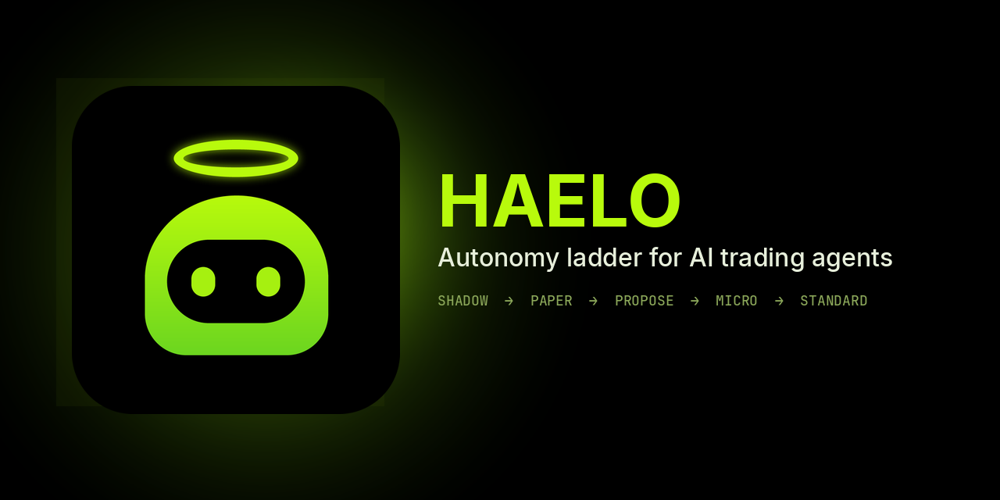
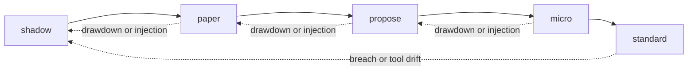
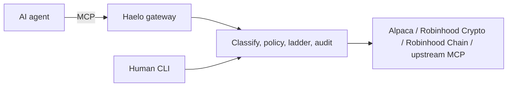

<p align="center">
  
</p>

<p align="center">
  <a href="https://github.com/HaeloBot/Haelo/actions/workflows/ci.yml"></a>
  <a href="https://github.com/HaeloBot/Haelo/actions/workflows/dynamic/github-code-scanning/codeql"></a>
  <a href="LICENSE"></a>
  <a href="https://github.com/HaeloBot/Haelo/releases/tag/v0.3.0"></a>
  <a href="package.json"></a>
  <a href="https://haelobot.com"></a>
</p>

<p align="center">
  An MCP gateway that puts an AI trading agent on a ladder: shadow, then paper, then a human, then a tiny live cap.
</p>

<p align="center">
  <a href="https://haelobot.com"><strong>haelobot.com</strong></a>
</p>

<p align="center">
  
</p>

> Not financial advice. Haelo limits how badly an agent can hurt you. It does not make trading safe or profitable. Read [Limitations](#limitations) and [SECURITY.md](SECURITY.md).

## Why Haelo

- A broker login is all-or-nothing. Haelo starts the agent in **shadow**: live quotes, simulated fills, nothing sent.
- **Promotion is human-only.** Criteria are written down first: days, decisions, invalid rate, breaches, injection follow-throughs, drawdown, no tool drift.
- **Demotion is automatic.** A hard breach or tool-list change goes back to shadow. Drawdown or an order after an injection flag drops one rung. Promotion then freezes for a cool-down (default 24 h).
- The agent has **no tool** that promotes, demotes, approves, or edits policy. It can ask (`haelo_request_promotion`) and read its status.
- **Live trading is off** until `live.enabled: true`. Force cannot override that. See [docs/GO_LIVE.md](docs/GO_LIVE.md).

## The ladder



| Rung | What an order does | Money at risk |
|---|---|---|
| `shadow` | Simulated against live quotes, with slippage and fees. Never reaches the broker. | none |
| `paper` | Sent to the broker's paper environment (Alpaca). Skipped when the broker has no paper environment. | none |
| `propose` | Held. You read an approval card built from the order fields and approve or decline. | only what you approve |
| `micro` | Sent live under tighter caps (default $25 / order, $100 / day, 5 orders / day). | tiny |
| `standard` | Sent live under the rails in your policy. | your limits |

## Quickstart

No broker account:

```bash
git clone https://github.com/HaeloBot/Haelo && cd Haelo
npm ci && npm run build

node dist/cli.js mock-upstream --port 8799 &
mkdir /tmp/haelo-demo && cd /tmp/haelo-demo
node /path/to/Haelo/dist/cli.js init --broker mock
node /path/to/Haelo/dist/cli.js policy lock
node /path/to/Haelo/dist/cli.js doctor
node /path/to/Haelo/dist/cli.js serve --http
```

Alpaca paper, after `ALPACA_PAPER_KEY_ID` and `ALPACA_PAPER_SECRET_KEY` are set:

```bash
haelo init --broker alpaca && haelo policy lock
haelo doctor
haelo serve --stdio
```

Robinhood Crypto and the upstream MCP path are in [docs/ADAPTERS.md](docs/ADAPTERS.md). Neither has been run against Robinhood by the author. Robinhood Chain swaps (Uniswap v3 on chain 4663) are in [docs/CHAIN.md](docs/CHAIN.md). Start at `shadow`.

Connect an agent with [`examples/claude-desktop.stdio.json`](examples/claude-desktop.stdio.json) or [`examples/cursor.mcp.json`](examples/cursor.mcp.json).

## Features

| | Plain broker MCP | Haelo in front |
|---|---|---|
| First order | Live, if the key is live | Shadow |
| Size | Whatever the model asks | Caps per rung. Unsized orders are refused |
| A bad day | Keeps going | Drawdown demotes. A breach returns to shadow |
| Tool list changes | The agent sees the new tools | Orders freeze until `haelo pin approve` |
| Prompt injection | The model's problem | A tripwire, then the rails anyway |
| Record | Logs, if you keep them | Hash chain. `haelo audit verify` checks it |
| Keys | Often in the agent config | Environment variables. Never in `haelo.yaml` |

The website playground runs the same policy, ladder, and audit code in the browser. It does not ask for broker keys. Live orders stay on the local CLI.

## Architecture



A call is classified by tool name. Annotations are not trusted. Transfers and unknown tools are hidden and blocked. Orders are sized or refused, checked for an injection window, evaluated against the rung's rails, then simulated, held, or sent. Details: [docs/ARCHITECTURE.md](docs/ARCHITECTURE.md). Every policy field: [docs/POLICY.md](docs/POLICY.md).

<details>
<summary>Human commands and the verification matrix</summary>

```
haelo status | report
haelo promote [--force]
haelo demote | panic
haelo proposals
haelo approve <id> | decline <id>
haelo approvals-ui
haelo doctor [--live]
haelo pin status | approve
haelo audit verify | tail | export
haelo policy lock | check | show
```

| Component | Status |
|---|---|
| MCP server, policy, ladder, shadow ledger, household checks, audit chain, storage, CLI, approvals UI | Verified by automated tests. Coverage is enforced in CI (lines ≥ 90%) |
| `haelo doctor` | Verified against local mocks. Read-only |
| Alpaca adapter | Real client for the documented endpoints. Checked against a local mock only, not yet against Alpaca |
| Robinhood Crypto client | Ed25519 signing checked against the official example. Endpoints checked against a mock only |
| Upstream MCP proxy | Streamable HTTP and OAuth 2.1 + PKCE checked against a local mock IdP. Not checked against Robinhood |
| Robinhood Chain | Uniswap v3 router and quoter from Uniswap's chain 4663 list. Quotes read from the public RPC. Live swaps are implemented and covered by a mocked chain. No testnet router is published, so no on-chain swap has been sent |
| Token storage | OS keychain when one exists, otherwise a mode `0600` file |
| Shadow fills | Quote ± slippage. A good shadow result is weak evidence about live results |
| Wash-sale and lot checks | Heuristic warnings, not tax advice. Crypto wash-sale checks are off by default |

</details>

## Security

The agent is treated as untrusted. Caps bound the loss. They do not make a trade good. Injection detection is a tripwire, not a wall. The audit log is tamper-evident, not tamper-proof. Run the gateway as a different OS user from the agent. Report vulnerabilities privately: [SECURITY.md](SECURITY.md).

<details>
<summary>Limitations</summary>

- A determined injection can evade the regexes. The rails are the real limit.
- If the agent can run a shell as the Haelo user, it can run `haelo promote`.
- Anyone who can rewrite the whole audit file can recompute the chain.
- Quotes are only as good as the broker feed. Free Alpaca data is IEX-only.
- No standing orders, and no chat-app approvals. Approvals are the CLI or the local web UI.
- One agent per state directory.

</details>

## Roadmap

Known gaps, not dates:

- The Alpaca and Robinhood Crypto adapters have not been run against those live services. `haelo doctor` and the smoke scripts are the way to check a real account.
- Robinhood Chain testnet (46630) has no published Uniswap router. Mainnet quotes can be checked with `haelo doctor`. A live swap still needs your own funded key. See [docs/CHAIN.md](docs/CHAIN.md).
- Robinhood does not publish its agentic-trading tool schemas, so the upstream proxy fails closed when it cannot parse an order.
- `$HAELO` on the website has no contract address until `website/public/config.json` is filled in. The page shows "CA coming soon" until then.

## Website

Live at [https://haelobot.com](https://haelobot.com).

<details>
<summary>Contract address and wallet</summary>

To publish the `$HAELO` address, edit only `website/public/config.json` (`token.ca`, and `buyUrlTemplate` with `{CA}`). Push to `main`. The page fetches that file with `cache: "no-store"`. Leave `ca` empty until you have the address.

The Connect wallet button uses Reown AppKit on Robinhood Chain only (`reown.projectId` in that same file). In the Reown dashboard, allowlist `haelobot.com` or the modal cannot finish a connection on that domain.

</details>

## Contributing

[CONTRIBUTING.md](CONTRIBUTING.md). Node 22.13 or newer. `npm ci && npm run lint && npm run typecheck && npm test`. The docs index is [docs/README.md](docs/README.md).

## License

MIT. Copyright 2026 Kavindu Diluka. See [LICENSE](LICENSE).
