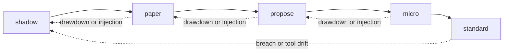
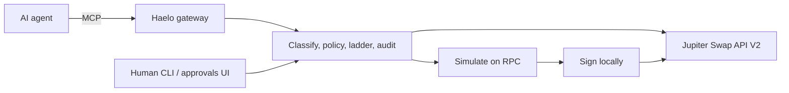

<p align="center">
  
</p>

<p align="center">
  <a href="https://github.com/HaeloBot/haelo-solana/actions/workflows/ci.yml"></a>
  <a href="LICENSE"></a>
  <a href="package.json"></a>
  
  <a href="https://haelobot.com"></a>
  <a href="https://x.com/HaeloBot"></a>
</p>

<p align="center">
  An MCP gateway that puts an AI trading agent on a ladder before it can swap real tokens on Solana:<br>
  shadow, then paper, then a human, then a tiny live cap.
</p>

<p align="center">
  
</p>

> Not financial advice. Haelo limits how badly an agent can hurt you. It does not make trading safe or profitable. Read [Limitations](#limitations) and [SECURITY.md](SECURITY.md).

## Why Haelo

- A wallet key is all-or-nothing. Haelo starts the agent in **shadow**: live Jupiter prices, simulated fills, nothing signed.
- **Nothing is signed blind.** Every live swap is simulated against your RPC first. Haelo refuses to sign if the wallet would lose more than the order allows or receive less than the quote minus slippage.
- **Promotion is human-only.** Criteria are written down first: days, decisions, invalid rate, breaches, injection follow-throughs, drawdown.
- **Demotion is automatic.** A hard breach goes back to shadow. Drawdown or an order after an injection flag drops one rung. Repeated failed sends drop to shadow. Promotion then freezes for a cool-down (default 24 h).
- The agent has **no tool** that promotes, demotes, approves, transfers, or edits policy.
- **Live trading is off** until `live.enabled: true`, and every live order also needs `confirm: true`. See [docs/GO_LIVE.md](docs/GO_LIVE.md).

## The ladder



| Rung | What a swap does | Money at risk |
|---|---|---|
| `shadow` | Fills on a virtual book at live Jupiter prices | none |
| `paper` | Real Jupiter route; the real transaction is simulated on chain, never signed | none |
| `propose` | Held. You approve or decline an approval card built from the order fields | only what you approve |
| `micro` | Signed and sent under tiny caps (default $25 / order, $100 / day, `SOL/USDC` only) | tiny |
| `standard` | Signed and sent under the rails in your policy | your limits |

## Install

```bash
npx haelo-solana --help
npm i -g haelo-solana        # installs the `haelo` command
```

Or from source:

```bash
git clone https://github.com/HaeloBot/haelo-solana && cd haelo-solana
npm ci && npm run build
node dist/cli.js --help
```

## Quickstart

No key is needed to start. Shadow and paper never sign.

```bash
haelo init                  # writes haelo.yaml (Solana mainnet-beta, Jupiter, live off)
haelo quote SOL/USDC        # live Jupiter price: checks the API and the RPC
haelo policy lock
haelo serve --stdio         # or: haelo serve --http
```

Add it to Claude Desktop or Cursor ([examples/](examples)):

```json
{
  "mcpServers": {
    "haelo": {
      "command": "npx",
      "args": ["-y", "haelo-solana", "serve", "--stdio", "--config", "/ABSOLUTE/PATH/TO/haelo.yaml"]
    }
  }
}
```

The agent then sees `get_quote`, `get_account`, `get_positions`, `place_order` and Haelo's own `haelo_*` tools. Ask it to buy $50 of SOL and it fills in shadow.

When it has earned it:

```bash
haelo key import --file agent-wallet.json   # dedicated wallet; stored in the OS keychain
haelo doctor --live
haelo promote
```

## Features

| | An agent holding a wallet key | Haelo in front |
|---|---|---|
| First swap | Signed, on mainnet | Shadow |
| Size | Whatever the model asks | Caps per rung. Unsized orders are refused |
| What gets signed | Whatever the route returns | Simulated first; refused if balances move more than the order allows |
| A bad day | Keeps going | Drawdown demotes. A breach returns to shadow |
| Prompt injection | The model's problem | A tripwire, then the rails anyway |
| Record | Explorer history, if you check | Hash chain. `haelo audit verify` checks it; every swap's Solscan link is in it |
| Key | In the agent's config | OS keychain, never in `haelo.yaml`, never printed |

## Architecture



How a swap is routed, checked and signed: [docs/SOLANA.md](docs/SOLANA.md). Every policy field: [docs/POLICY.md](docs/POLICY.md). Internals: [docs/ARCHITECTURE.md](docs/ARCHITECTURE.md).

<details>
<summary>Human commands and the verification matrix</summary>

```
haelo init | quote <pair>
haelo key import --file <id.json> | show | forget
haelo status | report
haelo promote [--force]
haelo demote | panic
haelo proposals
haelo approve <id> | decline <id>
haelo approvals-ui
haelo doctor [--live]
haelo audit verify | tail | export
haelo policy lock | check | show
```

| Component | Status |
|---|---|
| MCP server, policy, ladder, shadow ledger, audit chain, storage, CLI, approvals UI | Verified by automated tests. Coverage is enforced in CI (lines ≥ 90%) |
| Jupiter order/execute, RPC reads, simulation guard, signing | Verified against a local fake cluster that builds real Solana v0 transactions, checks ed25519 signatures, and simulates balance changes, including a draining route and an underpaying route that the guard refuses |
| `haelo doctor` | Read-only. Checks the cluster, mints, a Jupiter quote, the key and balances |
| Mainnet | API shapes follow Jupiter's and Solana's published specs. No swap has been sent to mainnet by the author: make your first live swap tiny |
| Key storage | OS keychain when one exists, otherwise a mode `0600` file |
| Shadow fills | Jupiter quote ± slippage. A good shadow result is weak evidence about live results |

</details>

## Security

The agent is treated as untrusted. Caps bound the loss. They do not make a trade good. Injection detection is a tripwire, not a wall. The audit log is tamper-evident, not tamper-proof. Use a dedicated wallet, a private RPC, and run the gateway as a different OS user from the agent. Report vulnerabilities privately: [SECURITY.md](SECURITY.md).

<details>
<summary>Limitations</summary>

- A determined injection can evade the regexes. The rails are the real limit.
- If the agent can run a shell as the Haelo user, it can run `haelo promote`.
- The guard trusts the RPC's simulation. Use an RPC you trust for live trading.
- Anyone who can rewrite the whole audit file can recompute the chain.
- Market swaps only. No limit orders, no perps, no bridges.
- One agent per state directory.

</details>

## Website

[haelobot.com](https://haelobot.com) runs the same policy, ladder and audit code in the browser on live Jupiter prices. In live mode the visitor's own Solana wallet (Phantom, Solflare, Backpack) signs, after the policy gate. The site never asks for a private key.

<details>
<summary>Contract address and wallet</summary>

To publish the `$HAELO` address, edit only `website/public/config.json` (`token.ca`, and `buyUrlTemplate` with `{CA}`). The page fetches that file with `cache: "no-store"`. Leave `ca` empty until you have the address.

</details>

## Contributing

[CONTRIBUTING.md](CONTRIBUTING.md). Node 22.13 or newer. `npm ci && npm run lint && npm run typecheck && npm test`. The docs index is [docs/README.md](docs/README.md).

## License

MIT. Copyright 2026 Kavindu Diluka. See [LICENSE](LICENSE).
